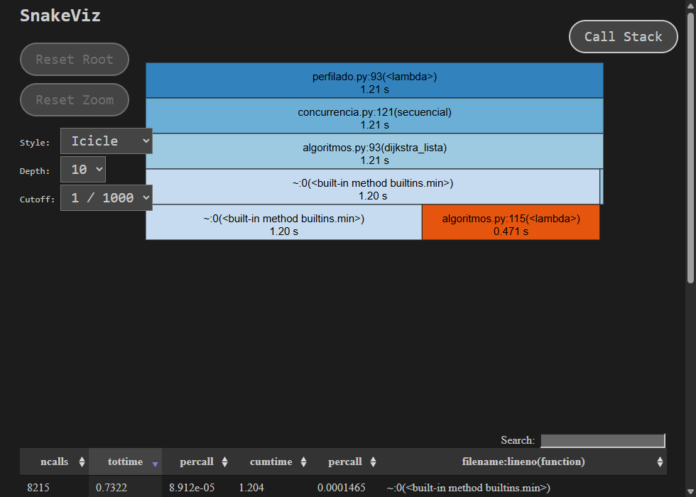
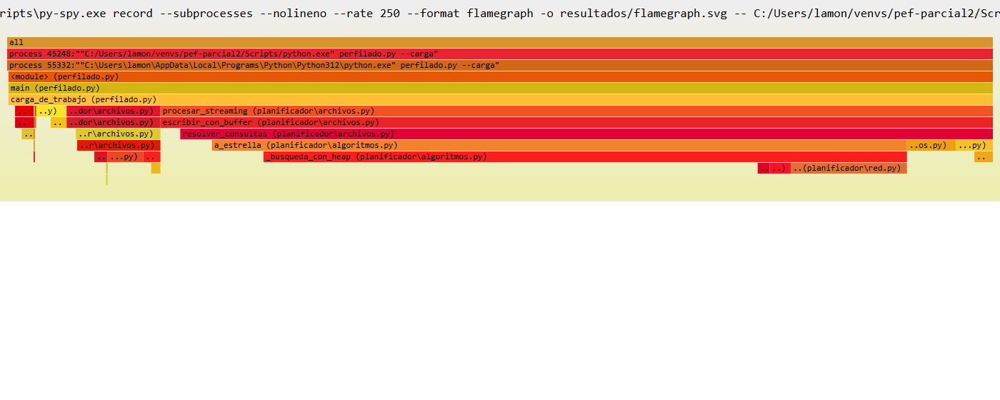
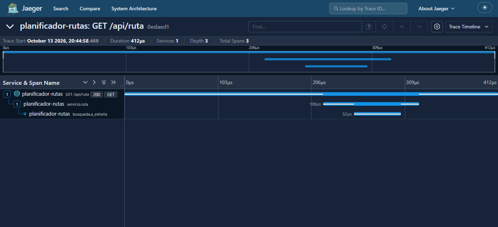
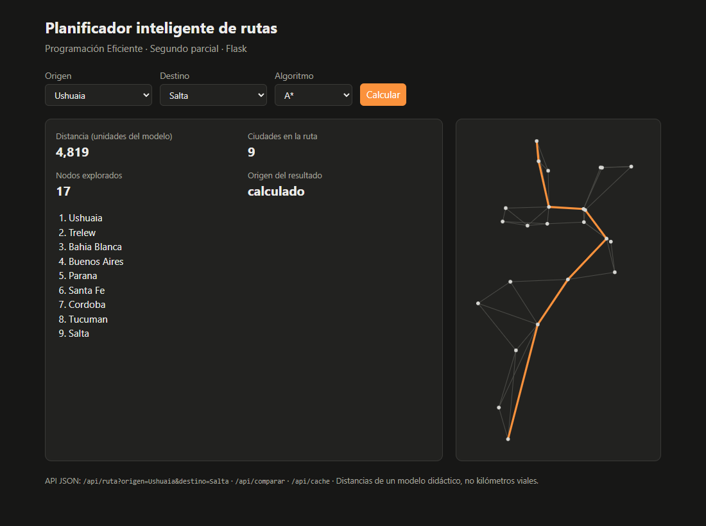

# Informe del segundo parcial

**Planificador inteligente de rutas** · Programación Eficiente · Python 3.12

Este informe recorre la consigna punto por punto: qué hicimos, cómo lo
medimos y qué aprendimos. Todo lo que aparece acá se puede regenerar con los
scripts del proyecto, y los archivos crudos están en la carpeta
`resultados/`.

**Equipo de medición:** Intel Core i7-14700K (8 núcleos de rendimiento y 12
de eficiencia, 28 hilos), 32 GB de RAM, Windows 11, Python 3.12.10. Los
bancos usan 8 procesos, como el primer parcial. La sección 12 explica por qué
esta CPU obliga a medir con cuidado.

## Resumen

| Consigna | Qué hicimos | Resultado principal |
|---|---|---|
| Eliminar código redundante | 9 duplicaciones, 2 cálculos repetidos y 1 atributo muerto eliminados | Dijkstra y A* comparten código; A* mantiene su velocidad |
| Compiladores y herramientas de optimización | SnakeViz, py-spy y Scalene, más PyPy (JIT) | `min()` = 98,9 % del baseline; PyPy 5,1x en bucles puros y 0,7x en A* |
| Herramienta general | OpenTelemetry + Jaeger (APM) | A* = 0,03 ms de una petición de 5,7 ms: el cuello está en HTTP |
| Archivos grandes | Streaming, buffer, lotes, procesos, SQLite por lotes | Tubería 238x; escritura ~3.600x; SQLite ~2.000x |
| Legibilidad y PEP 8 | Docstrings Google, tipos, 79 columnas, nombres | PEP 8: 76 → 0 avisos; docstrings faltantes: 37 → 0 |
| Sphinx | Documentación HTML desde los docstrings | `docs/_build/html/index.html` |
| Análisis de calidad | `calidad.py`: 7 dimensiones de SonarQube | Pylint 8,03 → 9,99; mantenibilidad 52,6 → 66,4 |
| Refactorización | 5 casos de 4 tipos de *bad smell* corregidos | Complejidad máxima 12 → 9 |
| Testing | 116 tests de 7 tipos | Cobertura 96 %; un error del primer parcial detectado |
| Framework | API y página web con Flask | Probada con el cliente de Flask y con carga real |

---

## 1. Eliminar código redundante

La diapositiva 134 define el código redundante como "cálculos innecesarios o
duplicados". Encontramos los dos tipos.

**Código duplicado:**

| Qué estaba repetido | Dónde | Cómo quedó |
|---|---|---|
| `titulo()` | `main.py`, `banco.py`, `perfilado.py` | `planificador/consola.py` |
| `cronometrar()` | `banco.py`, `concurrencia.py` | `planificador/mediciones.py` |
| Generar consultas al azar | `generar_lote` y `generar_consultas` | una sola función en `consultas.py` |
| `dijkstra_heap` y `a_estrella` | mismo algoritmo: solo 4 de 28 líneas distintas (las de la heurística) | `_busqueda_con_heap(heuristica)`: Dijkstra es A* con h = 0 |
| Crear el pool de procesos | `con_procesos`, `rutas_con_procesos`, `medir_arranque_de_pool` | `crear_pool()` y `_mapear_en_procesos()` |
| Bloque de medición repetido 5 veces | `medir_tabla` | la tabla se arma desde una lista de etapas |
| Demostraciones en `__main__` | `algoritmos`, `cache`, `concurrencia`, `red` | eliminadas: ya las muestran `main.py` y `banco.py` |
| Cronómetros escritos a mano con `perf_counter` | `banco.medir_escalabilidad`, `concurrencia.medir_arranque_de_pool` | usan `cronometrar()` |
| "Resolver todas las consultas" | `concurrencia._resolver`/`secuencial`, `banco._correr_secuencial` | `concurrencia.secuencial(red, consultas, algoritmo)` |

**Código muerto:** `Red.version` se incrementaba en cada corte y su docstring
decía que la caché lo usaba, pero nadie lo leía. Lo encontró la revisión, no
una herramienta: se eliminó.

**Cálculos repetidos:**

- `main.py` calculaba A* dos veces para la misma consulta. Ahora reutiliza el
  primer resultado.
- `banco.py` calculaba dos veces `factor_v`.

**¿Unificar Dijkstra y A* cuesta rendimiento?** Lo medimos contra el código
del primer parcial sobre la red de 12.100 nodos, en varias corridas. **A*
quedó igual** (entre −3 % y +3 %, ruido). **Dijkstra con heap quedó entre 2 %
y 8 % más lento**: ahora paga una llamada a la heurística nula por cada
tramo. Lo aceptamos a propósito: Dijkstra con heap es solo una versión de
comparación (la aplicación usa A*) y a cambio hay un único lugar que
mantener. Las rutas, los costos y los nodos explorados son idénticos.

**Una redundancia que decidimos NO eliminar.** Dentro de A* la heurística se
calcula de nuevo cada vez que se mejora un nodo: cerca del **28 %** de las
llamadas repite un nodo ya calculado (medido en la grilla de 12.100 nodos).
Probamos guardarla en un diccionario y resultó **más lento (entre 0 % y 10 %
según la corrida)**: consultar el diccionario cuesta lo mismo que
`math.hypot`. Lo dejamos documentado en el código. Es el criterio
de la unidad 8: no se optimiza sin medir, y lo que no mejora no entra.

**Las herramientas no ven la duplicación semántica.** Pylint (R0801) compara
líneas textuales y no detectó que Dijkstra y A* eran casi iguales. La
duplicación la encontramos leyendo el código; las herramientas confirman,
pero no reemplazan esa revisión.

## 2. Compiladores y herramientas de optimización

La consigna pide al menos una de Scalene, py-spy o SnakeViz para Python.
Usamos las tres, cada una para lo que mejor hace, y sumamos PyPy como
compilador JIT.

### SnakeViz: dónde se va el tiempo, en un gráfico

`python perfilado.py` guarda los perfiles de cProfile y `snakeviz
resultados/perfil_antes.prof` los muestra. En el baseline, `min()` y la
`lambda` de su clave ocupan 1,20 de los 1,21 segundos:



line_profiler lo confirma a nivel de línea: la línea `actual =
min(pendientes, key=...)` consume el **98,9 %** del tiempo de la función y se
ejecuta 2.473 veces, recorriendo en cada una todos los pendientes: es el
O(V²). La `lambda` se llama 11.641.991 veces.

### py-spy: flame graph sin tocar el código

py-spy muestrea el programa mientras corre, sin decoradores ni
modificaciones. Perfilamos la carga de `perfilado.py --carga` (746
muestras):



| Función | Tiempo |
|---|---:|
| `procesar_streaming` (tubería sin caché) | 84 % |
| ↳ `resolver_consultas` | 82 % |
| ↳ ↳ `a_estrella` | 71 % |
| ↳ escritura con buffer | menos del 3 % |
| `procesar_por_lotes` (con caché) | 10 % |

**Conclusión:** una vez puesto el buffer, escribir dejó de ser el problema. El
tiempo está en A* recalculando consultas repetidas (500 pares distintos en
300.000 consultas). Eso justificó la caché de la versión V2.

En Windows, py-spy necesita `--subprocesses`: el `python.exe` de un entorno
virtual es un lanzador que arranca el intérprete real como proceso hijo.

### Scalene: memoria por línea

Scalene atribuyó el **100 %** de la memoria del programa a dos líneas de la
versión ingenua: el parseo dentro de `leer_todo` (40 MB), `readlines()`
(20 MB) y armar la lista final (10 MB). Reporte navegable:
`resultados/scalene.html`.

**Limitación encontrada:** en Windows nativo Scalene no pudo medir la CPU de
nuestro código. Sin opciones no registró muestras, y con `--profile-all`
atribuyó la mayor parte del tiempo (83 % en nuestra prueba) a su propio
hilo (`threading.py`). Por eso
repartimos: Scalene para memoria y py-spy para CPU. En Linux, macOS o WSL,
Scalene mide las dos cosas.

### PyPy: compilador JIT con el mismo código

`python compiladores.py --comparar <pypy.exe>` corre las mismas cargas en
CPython 3.12 y en PyPy 3.12 (v8.0.0):

| Carga | CPython | PyPy (1ª corrida) | PyPy (mejor) | Mejora |
|---|---:|---:|---:|---:|
| Dijkstra lista: bucle con `min()` y `lambda` | 0,27 s | 0,06 s | 0,05 s | **5,1x** |
| A*, 300 consultas en 12.100 nodos | 0,36 s | 0,60 s | 0,55 s | 0,7x |
| Tubería de archivos, 100.000 consultas | 0,90 s | 1,30 s | 1,30 s | 0,7x |

Es lo que anticipa la diapositiva 142. PyPy gana cuando el tiempo está en
**bucles de Python puro**. Pierde cuando el programa ya se apoya en partes de
CPython escritas en C: A* usa `heapq`, que en CPython es el módulo C
`_heapq` y en PyPy es código Python (en una prueba aparte, con 10 rondas
de calentamiento, PyPy se quedó en 0,52 s contra 0,35 s). La tubería depende del
formateo de texto y la E/S, también optimizados en C.

Además, PyPy **no implementa `tracemalloc`**. Tuvimos que importarlo solo
dentro de la función que mide memoria para que el paquete funcionara con
PyPy. Cambiar de implementación no siempre es gratis.

## 3. Herramienta general de monitoreo: OpenTelemetry + Jaeger

La consigna nombra YourKit, New Relic y Elastic APM, y acepta cualquier otra.
Elegimos **OpenTelemetry**, el estándar abierto de instrumentación, con
**Jaeger** como servidor de trazas:

- El agente de Python de New Relic no soporta Windows, y Elastic APM necesita
  levantar Elasticsearch, Kibana y APM Server (Docker no está instalado).
  YourKit apunta sobre todo a Java y .NET y es comercial.
- Jaeger es un único ejecutable, gratis y local.
- El código no queda atado a Jaeger: New Relic, Elastic APM y Dynatrace
  reciben el mismo protocolo OTLP. Cambiar de herramienta es cambiar el
  `--endpoint`.

**Qué instrumentamos** (`planificador/telemetria.py`): Flask genera un *span*
por petición, y le agregamos uno para la capa de servicio (con el atributo
`cache.acierto`) y otro para cada cálculo de A* (con `busqueda.explorados`).
Los spans se envían con `BatchSpanProcessor`, de a lotes y en otro hilo: es el
batching de la unidad 5 aplicado a la telemetría.



En esa traza (un fallo de caché) la petición tardó 412 µs: 106 µs en la
capa de servicio, de los cuales 52 µs fueron el cálculo de A*.

**Resultado con 400 peticiones de 8 hilos** (`carga_api.py`, con un corte de
tramo a mitad de camino):

| Medición | Mediana | p95 |
|---|---:|---:|
| Latencia que ve el cliente | 5,74 ms | 27,2 ms |
| Petición dentro del servidor (`GET /api/ruta`) | 0,335 ms | 0,67 ms |
| Capa de servicio, con lock y caché | 0,015 ms | 0,11 ms |
| Cálculo de A* (solo en los 77 fallos de caché) | 0,031 ms | 0,058 ms |

Jaeger registró 323 aciertos y 77 fallos de caché, y el corte invalidó 22
rutas. **El hallazgo:** A* es el 9 % del tiempo del servidor y menos del 1 %
de lo que espera el usuario. Más del 90 % de la latencia está en HTTP, la
conexión y el encolado. Optimizar más el algoritmo no mejoraría la API. Esto
es justamente lo que promete un APM (diapositiva 185): mostrar dónde está
realmente el cuello de botella.

**Problema encontrado y resuelto:** en la primera corrida todos los spans
duraban 0 ms. En Python 3.12 sobre Windows, `time.time_ns()` (el reloj que usa
OpenTelemetry) tiene una resolución de 15,6 ms (`GetSystemTimeAsFileTime`).
Le dimos al SDK un reloj basado en `perf_counter_ns`, anclado una vez a la
hora real, y lo cubrimos con un test de regresión. Python 3.13 ya no necesita
esta corrección.

## 4. Lectura y escritura de archivos grandes

`planificador/archivos.py` resuelve el caso de una empresa que recibe un
archivo con cientos de miles de pedidos de ruta y devuelve otro con los
resultados. Está armado como una tubería de generadores (leer → resolver →
escribir) para poder cambiar y medir cada técnica por separado. Mediciones
de `python banco_es.py`. Los tiempos son el mínimo de 3 corridas, y las filas
con * se midieron sobre una muestra y se proyectaron.

### Lectura de 1.000.000 de líneas

| Variante | Tiempo | Memoria pico |
|---|---:|---:|
| `readlines()`: todo en memoria | 281 ms | **224,2 MB** |
| Streaming línea a línea (generador) | 377 ms | **0,0 MB** |
| Lotes de 10.000 líneas | 454 ms | 3,2 MB |

El streaming no es más rápido: `readlines()` lee en bloque desde C. Pero su
memoria no depende del tamaño del archivo, y eso es lo que permite procesar
archivos que no entran en RAM. Los lotes no aceleran la lectura en sí:
sirven para agrupar lo que viene después (escritura, envío a procesos,
inserts).

### Escritura de 1.000.000 de líneas

| Variante | Tiempo | Mejora |
|---|---:|---:|
| Abrir y cerrar el archivo por línea | 4,8 min * | 1x |
| Una apertura, buffer de 8 KiB (el de Python) | 111 ms | 2.576x |
| Una apertura, buffer de 1 MiB | 94 ms | 3.033x |
| Lotes con `writelines` y buffer de 1 MiB | **79 ms** | **3.629x** |

Abrir y cerrar el archivo son llamadas al sistema operativo: en esta
medición costaron unos 290 µs por línea en Windows (con el antivirus de por
medio). El buffer junta miles de líneas en
una sola escritura a disco.

### Tubería completa: 200.000 consultas sobre el mapa argentino

| Versión | Qué cambia | Tiempo | Mejora |
|---|---|---:|---:|
| V0 Ingenua | `readlines()`, sin caché, abre la salida por línea | 1,0 min | 1x |
| V1 Streaming + buffer | generador y una sola apertura | 2,94 s | 21x |
| V2 Lotes + caché | + caché de rutas y `writelines` por lote | 318 ms | 194x |
| V3 Lotes en paralelo | + lotes repartidos en 8 procesos | **258 ms** | **238x** |

Las cuatro salidas son **idénticas byte a byte**: se verifica en cada
corrida. La mayor parte de la mejora viene del buffer y de la caché. Los
procesos suman poco (1,2x sobre V2) porque, con la caché, cada consulta del
mapa chico es casi gratis y pesan el arranque del pool y el envío de los
lotes.

Detalles de diseño de V3: `Executor.map` lee todo el iterable antes de
empezar, así que usamos `submit` con una ventana de 16 lotes en vuelo (la
memoria no crece con el archivo). Cada proceso recibe el mapa una sola vez
por el *initializer*, y devuelve el lote ya formateado como un único `str`,
mucho más barato de serializar que miles de tuplas.

### Paralelismo cuando el cálculo domina: 4.000 consultas distintas, 12.100 nodos

| Variante | Tiempo |
|---|---:|
| Lotes en el proceso principal | 9,62 s |
| Lotes en 1 proceso nuevo (referencia justa) | 7,05 s |
| Lotes en 2 procesos | 2,71 s |
| Lotes en 4 procesos | 1,61 s |
| Lotes en 8 procesos | **1,27 s** |

Contra la referencia de 1 proceso, 8 procesos rinden **5,6x**. La fila de 1
proceso es la comparación justa: paga los mismos costos (arranque, envío del
mapa) y corre en un proceso nuevo. Que 2 procesos den más de 2x no es
paralelismo "mágico": es un efecto de esta CPU, explicado en la sección 12.

### Base de datos: 200.000 filas en SQLite

| Variante | Tiempo | Mejora |
|---|---:|---:|
| Un `INSERT` y un `commit` por fila | 20,8 min * | 1x |
| `executemany` y un `commit` por lote de 1.000 | **0,61 s** | **2.058x** |

Cada `commit` obliga a SQLite a asegurar los datos en disco: con lotes se
paga 200 veces en lugar de 200.000.

### Archivos "raros"

Una prueba adversarial buscó romper la lectura y encontró casos que
corregimos: archivos con BOM (los que guardan el Bloc de notas y Excel) se
leen bien con `utf-8-sig`; los espacios alrededor de las ciudades se
recortan; una línea mal formada o un archivo que no es UTF-8 dan un error con
el **número de línea**; y si la entrada no existe o es el mismo archivo que
la salida, se rechaza **antes** de abrir la salida, así no se pierden datos.
Con datos válidos las cuatro versiones dan siempre el mismo archivo; si el
archivo tiene un error, todas se detienen con el mismo mensaje. Es el ejemplo de las diapositivas
199–200.

## 5. Legibilidad y mantenibilidad

- **PEP 8** con el límite de 79 caracteres de la diapositiva 226, aplicado
  con `ruff format` y verificado con pycodestyle y flake8. Avisos: **76 → 0**
  (pycodestyle) y 77 → 0 (flake8). Entre ellos había una variable `l`
  (ambigua con `1`, E741) y un f-string sin variables.
- **Docstrings estilo Google** en todos los módulos, clases y funciones
  públicas, con `Args`, `Returns`, `Raises` y ejemplos ejecutables (doctest).
  Faltantes: **37 → 0**.
- **Anotaciones de tipo** (PEP 484) en todas las firmas públicas.
- **Nombres**: `monticulo` → `frontera`, `g` → `costo_hasta`, `i`/`j` →
  `fila`/`columna`, `r_sec` → `costos_sec`. La excepción nueva de la API se
  llama `ConsultaInvalidaError`: PEP 8 pide el sufijo `Error` y Ruff lo
  controla (regla N818).
- **Comentarios que explican por qué**, no qué. Por ejemplo, por qué no se
  memoiza la heurística o por qué las salidas usan `newline="\n"`.
- **Organización**: paquete `planificador/` con dependencias en una sola
  dirección (ver `ARCHITECTURE.md`), y configuración de todas las
  herramientas en `pyproject.toml`.
- **Markdown** (diapositivas 251–252): `README.md`, `ARCHITECTURE.md`,
  `CHANGELOG.md`, `CONTRIBUTING.md` y este informe.

## 6. Refactorización

Los *bad smells* de Fowler (diapositivas 253–259) que encontramos:

| Smell | Dónde | Refactorización |
|---|---|---|
| Long Method | `banco.main()`: 95 sentencias, complejidad 12 | *Extract Method*: funciones `medir_*` (devuelven datos) e `imprimir_*` |
| Long Method | `main.main()`: 76 sentencias | cuatro funciones, una por sección |
| Duplicate Code | ver sección 1 | funciones compartidas |
| Long Parameter List | `_conectar(red, a, b, rng, factor_min, factor_max)`: 6 parámetros | el rango del factor va en una tupla |
| Large Class | `CacheDeRutas`: 9 atributos | contadores en un `dataclass Contadores` |

Además separamos la presentación del cálculo: las funciones que miden ya no
imprimen, y por eso se pueden testear. Resultado (Radon): complejidad máxima
**12 → 9** y promedio 2,90 → 2,39; índice de mantenibilidad promedio **52,6 →
66,4**.

La única advertencia de Pylint que quedó es intencional: `_busqueda_con_heap`
tiene 16 variables locales (el límite es 15). Partirla agregaría llamadas a
función dentro del bucle más ejecutado del programa: priorizamos rendimiento
sobre una regla de estilo, y queda documentado.

## 7. Documentación con Sphinx

`python -m sphinx -b html docs docs/_build/html` genera la documentación
desde los docstrings, con:

- `autodoc`, que lee los docstrings;
- `napoleon`, que entiende el estilo Google;
- `viewcode`, que enlaza cada función con su código fuente;
- `myst_parser`, que incluye los Markdown del proyecto, este informe entre
  ellos.

Es la arquitectura de la diapositiva 240: código → docstrings → Sphinx →
HTML. La página principal es `docs/_build/html/index.html`.

## 8. Análisis de calidad (equivalente local a SonarQube)

SonarQube necesita un servidor. `python calidad.py` mide las mismas siete
dimensiones de la diapositiva 242 con herramientas locales, y con **la misma
configuración** para los dos parciales:

| Dimensión | Herramienta | Parcial 1 | Parcial 2 |
|---|---|---:|---:|
| Bugs | Pylint (E) + Ruff (pyflakes) | 1 | 0 |
| Vulnerabilidades | Bandit | 4 | 0 |
| Code smells | Pylint (C/R/W) | 162 | 1 |
| Duplicación | Pylint (R0801) | 0 | 0 |
| Docstrings faltantes | Ruff (D, Google) | 37 | 0 |
| Estilo PEP 8 | pycodestyle | 76 | 0 |
| Complejidad promedio / máxima | Radon CC | 2,90 / 12 | 2,39 / 9 |
| Mantenibilidad promedio / mínima | Radon MI (0–100) | 52,6 / 35,5 | 66,4 / 46,7 |
| Cobertura de tests | pytest-cov | sin tests | **96 %** |
| **Puntaje global** | Pylint (0–10) | 8,03 | **9,99** |

Las cuatro "vulnerabilidades" del primer parcial eran usos de `random`, que
Bandit marca porque no sirve para criptografía. Para una simulación es
correcto: lo justificamos con `# nosec B311` y un comentario. En el segundo
parcial quedan 9 marcas `# nosec`, cada una con su justificación: `random` en
simulaciones (B311), `subprocess` con argumentos fijos (B404, B603) y la URL
local del generador de carga (B310). Una herramienta de calidad señala; la
decisión es nuestra.

La fila de duplicación da 0 en los dos parciales: Pylint compara líneas
textuales y no vio que Dijkstra y A* eran el mismo algoritmo. Esa duplicación
la encontramos leyendo el código (sección 1).

## 9. Testing

`pytest` corre **116 tests** en unos 3 segundos (9 con cobertura):

| Tipo (diapositiva 272) | Ejemplos |
|---|---|
| Unitarios | grafo, algoritmos, caché, lotes, formato, archivos raros (BOM, UTF-16, mismo archivo) |
| Integración | la API completa con el cliente de pruebas de Flask |
| Funcionales | `main.py` ejecutado como lo haría un usuario |
| Regresión | la ruta Ushuaia–Salta sigue costando 4.819 con 17 nodos explorados; spans con duración positiva |
| Rendimiento | con `timeit`: heap más rápido que lista, acierto de caché 50x más rápido, streaming con 20x menos memoria |
| Doctests | 44 ejemplos en 19 docstrings, ejecutados como pruebas |
| Con mocks | `unittest.mock` verifica que un acierto de caché no llama al algoritmo |

También hay tests escritos con `unittest`, que pytest corre igual
(diapositiva 275), y fixtures para los mapas. Cobertura de ramas: **96 %**.
Lo que falta es sobre todo código que corre dentro de procesos hijos
(coverage no los mide por defecto) y algunos caminos de error de la API.

**Los tests encontraron un error del primer parcial.** `main.py` tomaba
siempre `ruta[2]` y `ruta[3]`, y fallaba con `IndexError` cuando la ruta
tenía menos de cuatro ciudades (`python main.py Rosario "Santa Fe"`) o con
origen igual a destino. Está corregido y cubierto por un test.

## 10. Framework: Flask

`planificador/api.py` expone el planificador como servicio web
(diapositivas 318–319):

- `GET /api/ruta`, `/api/comparar`, `/api/ciudades`, `/api/cache`;
  `POST /api/tramos/cortar` y `/api/reiniciar`.
- Una página con formulario y mapa SVG, hecha con `render_template` y Jinja.
- *Application factory* (`crear_app`): cada test crea una aplicación limpia.
- Errores de entrada (ciudad o algoritmo desconocidos) → HTTP 400 con
  mensaje. Sin ruta posible → 404.
- **Lock en la capa de servicio:** el servidor atiende cada petición en un
  hilo, y la caché modifica un `OrderedDict` en cada consulta. Sin lock, dos
  hilos podrían corromperla. En el primer parcial no hacía falta porque las
  consultas solo leían.
- Se sirve con **waitress**, un servidor de producción en Python puro que
  funciona en Windows. El servidor de Flask es solo para desarrollo.
- **Prueba de estrés:** con hasta 150 hilos y más de 40.000 peticiones que
  mezclaban consultas, cortes y reinicios, no hubo errores 500 ni rutas que
  usaran un tramo ya cortado. La misma prueba encontró dos fallas que
  corregimos: un cuerpo JSON que no era un objeto daba 500 (ahora 400), y en
  Windows un segundo `servidor.py` en el mismo puerto arrancaba sin error
  mientras el viejo seguía atendiendo (ahora avisa y sale).

Elegimos Flask y no Django porque necesitábamos una API chica sin base de
datos ni panel de administración. FastAPI no aportaba ventajas: el trabajo
es de CPU y no se beneficia de `async`.



## 11. Las mediciones del primer parcial, revisadas

Al reorganizar `banco.py` encontramos un problema de método en la tabla
comparativa del primer parcial: **medía el tiempo con `tracemalloc`
activo**. `tracemalloc` registra cada objeto que se crea. Medimos su
efecto con `perfilado.py` (sección 6 de `resultados/perfilado.txt`, grilla
de 2.025 nodos):

| Algoritmo | Sin tracemalloc | Con tracemalloc | Efecto |
|---|---:|---:|---:|
| Dijkstra con heap | 0,584 ms/consulta | 2,45 ms/consulta | 4,2x más lento |
| A* | 0,254 ms/consulta | 0,816 ms/consulta | 3,2x más lento |
| Dijkstra con lista | 40,1 ms/consulta | 42,1 ms/consulta | sin cambio |

El baseline casi no crea objetos, pero el heap y A* crean muchos. Además
`tracemalloc` no ve a los procesos hijos. Resultado: la tabla del primer
parcial **subestimaba** las mejoras del heap y de A* y **exageraba** la de
los procesos. Ahora el tiempo se mide sin `tracemalloc` (mínimo de 2
corridas) y la memoria en otra pasada:

| Versión | Parcial 1 (otra PC, Python 3.14, medición mezclada) | Parcial 2 (esta PC, Python 3.12, corregido) |
|---|---:|---:|
| Implementación inicial (proyectada) | 1,0 h | 1,5 h |
| Dijkstra con heap | 22,8 s (160x) | 17,2 s (**307x**) |
| A* | 7,31 s (497x) | 4,40 s (**1.197x**) |
| A* en 8 procesos | 1,24 s (2.939x) | 0,88 s (5.981x) |
| Final: deduplicación + procesos + caché | 0,84 s (4.305x) | 0,71 s (**7.410x**) |

La conclusión del primer parcial se mantiene: la mayor mejora vino de cambiar
la estructura (heap) y el algoritmo (A*). Pero ahora los números la muestran
con su tamaño real.

## 12. Lo que aprendimos sobre medir

1. **La CPU híbrida mete ruido.** En pruebas puntuales en el i7-14700K, el
   mismo cálculo de A* tardó 0,34 s con el hilo "despierto" y 0,6 s después
   de una pausa de 4 s.
   En núcleos de eficiencia tarda 0,65 s siempre. Además, después de unos
   3 s de trabajo continuo en un hilo cada tanda tarda el doble (de 0,58 a
   1,3 s cada 500 consultas), con o sin caché. Por eso repetimos y tomamos el
   mínimo, como `timeit`: el ruido solo puede sumar tiempo. También explica
   las aceleraciones de más de N con N procesos, y que la última fila de la
   tabla de escalabilidad crezca más que lo teórico (x27 contra x16 ideal en
   O(V²)): cada proceso trabaja menos tiempo seguido y pasa más tiempo en la
   ventana rápida.
2. **Medir tiempo y memoria por separado.** `tracemalloc` multiplica por 3 o 4
   el tiempo del código que crea muchos objetos (sección 11).
3. **El reloj también tiene resolución.** Los 15,6 ms de `time_ns()` en
   Windows dejaban todas las trazas en 0 (sección 3).
4. **Un banco también puede tener errores.** Una versión de `banco_es.py`
   reutilizaba un generador ya consumido y "escribía" un millón de líneas en
   0,4 ms. Ahora verifica la cantidad escrita en cada repetición.
5. **Medir antes de optimizar.** La heurística memoizada (sección 1) y la
   caché con consultas que no se repiten (no ayuda: solo agrega el costo de
   indexar) muestran que una optimización razonable en teoría puede no
   servir en la práctica.

## 13. Conclusiones

- **Mayor impacto:** el buffer y los lotes en E/S (de 2.500x a 3.600x en
  escritura, ~2.000x en SQLite) y, en el cálculo, el heap y A* (1.197x
  contra el baseline).
- **Lo que no dio lo esperado:** memoizar la heurística (más lento), PyPy en
  A* y en la tubería (0,7x), y los procesos sobre el mapa chico (1,2x).
- **Qué haríamos distinto:** medir en Linux o con la frecuencia de la CPU
  fija para obtener números más estables, usar conexiones persistentes
  (keep-alive) en el cliente de la API (la red domina su latencia) y llevar
  las métricas de OpenTelemetry, además de las trazas, a un panel.

## Cómo reproducir

```bash
python banco.py          # sección 11
python banco_es.py       # sección 4
python perfilado.py      # sección 2 (cProfile, line_profiler, memory_profiler)
python compiladores.py --comparar C:\ruta\a\pypy.exe
python calidad.py        # sección 8
pytest                   # sección 9
python servidor.py --telemetria   # sección 3: en una terminal, con Jaeger corriendo
python carga_api.py               # sección 3: en otra terminal
```
