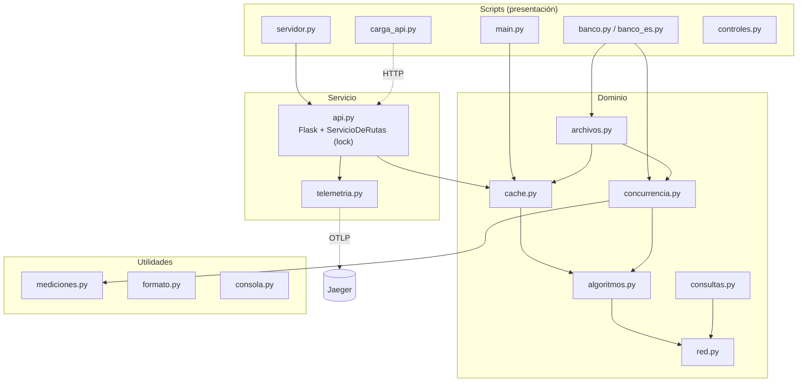
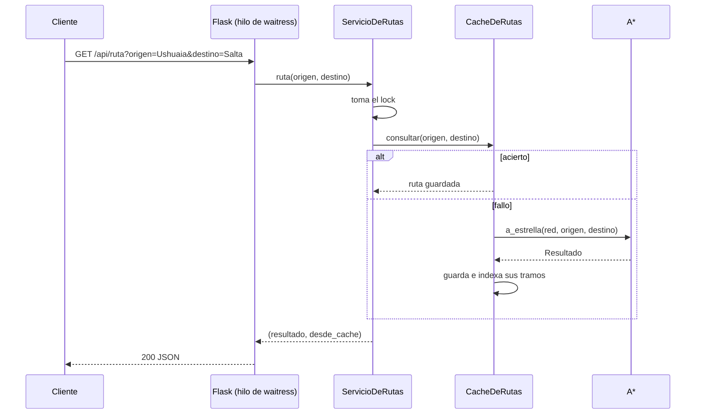

# Arquitectura

## Diagrama de componentes



Las dependencias van siempre hacia abajo: `red` no conoce a nadie,
`algoritmos` solo conoce a `red`, y la API usa el dominio pero el dominio no
sabe que existe una API. Los scripts son delgados: arman los datos, llaman al
paquete e imprimen.

## Módulos y responsabilidades

| Módulo | Responsabilidad | Depende de |
|---|---|---|
| `red.py` | Grafo no dirigido con pesos (lista de adyacencia), generadores de grillas y del mapa argentino | — |
| `algoritmos.py` | BFS, Dijkstra con lista, Dijkstra con heap y A*; tipo `Resultado` | `red` |
| `cache.py` | Memoización con `lru_cache` y `CacheDeRutas` (LRU + invalidación por tramo) | `algoritmos`, `red` |
| `concurrencia.py` | Resolver lotes de consultas en secuencia, con hilos o con procesos | `algoritmos`, `consultas`, `mediciones` |
| `consultas.py` | Lotes de consultas reproducibles (semilla fija) | `red` |
| `archivos.py` | E/S de archivos grandes: streaming, buffer, lotes, procesos y SQLite | `cache`, `concurrencia`, `algoritmos` |
| `api.py` | Aplicación Flask y `ServicioDeRutas`, que protege la caché con un lock | `cache`, `algoritmos`, `telemetria` |
| `telemetria.py` | Trazas OpenTelemetry exportadas por OTLP | `opentelemetry` |
| `mediciones.py`, `formato.py`, `consola.py` | Cronómetro, pico de memoria, unidades legibles e impresión | — |

## Dependencias externas

| Paquete | Para qué | Dónde |
|---|---|---|
| Flask 3.1, Werkzeug, Jinja2 | API web y página | `api.py` |
| waitress 3.0 | Servidor WSGI multi-hilo (Windows y Linux) | `servidor.py` |
| opentelemetry-sdk / exporter / instrumentation-flask | Trazas (APM) | `telemetria.py` |

El núcleo (`red`, `algoritmos`, `cache`, `concurrencia`, `archivos`) usa
solo la biblioteca estándar. Las versiones exactas, incluidas las
dependencias indirectas, están en `requirements.txt`.

## Flujo de una petición a la API



## Flujo de un archivo grande

```text
archivo de consultas ──► leer_consultas()  ──► resolver_consultas()  ──► escribir_por_lotes() ──► archivo de resultados
                         generador (streaming)  generador + caché        writelines + buffer

procesar_en_paralelo():
  leer_consultas_por_lotes() ──► submit(lote) a N procesos ──► ventana de 2·N lotes en vuelo ──► escribir en orden
```

## Estructura del repositorio

```text
planificador/        paquete principal (ver tabla de módulos)
tests/               119 pruebas: unitarias, integración, API, doctests, rendimiento relativo, controles.py
benchmarks/          benchmark, memoria, complejidad medida y linea_base.json
docs/                esta documentación (MkDocs)
.github/             pipeline de CI (workflows/ci.yml) y Dependabot
controles.py         los controles del CI, para correr localmente
main.py banco.py banco_es.py perfilado.py compiladores.py servidor.py carga_api.py
resultados/          mediciones de los parciales anteriores
```
