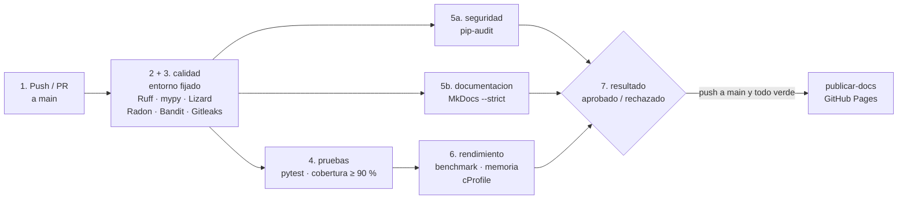

# Integración continua

## Plataforma

**GitHub Actions**, definido en `.github/workflows/ci.yml`. Se ejecuta
automáticamente:

- en cada **push** a `main`;
- en cada **pull request** hacia `main`;
- a mano (*Run workflow*), con la opción de regenerar la línea base de
  rendimiento en el runner.

La rama `main` está protegida y exige el check **`resultado`**: si cualquier
etapa falla, GitHub no deja integrar el pull request.

## Etapas del pipeline

| Etapa | Job | Qué hace | Por qué en ese lugar |
|---|---|---|---|
| 1. Integración del código | (disparador) | Push o pull request hacia `main` | — |
| 2. Preparación del entorno | cada job | `actions/setup-python` con Python 3.14 y caché de pip; `pip install -r requirements-dev.txt` con todas las versiones fijadas | Instalación reproducible: el runner usa lo mismo que cada integrante |
| 3. Calidad estática | `calidad` | Ruff, mypy, Lizard, Radon, Bandit, Gitleaks | Lo más rápido (2 s en local, sin contar la instalación): si falla, no se gasta tiempo en el resto |
| 4. Pruebas y cobertura | `pruebas` | pytest con cobertura de ramas ≥ 90 % | Necesita que el código al menos sea válido |
| 5. Seguridad de dependencias y documentación | `seguridad`, `documentacion` | pip-audit; MkDocs `--strict` | No dependen de las pruebas: corren **en paralelo** con ellas |
| 6. Rendimiento y memoria | `rendimiento` | Benchmark contra línea base, tracemalloc, complejidad medida y cProfile | Lo más costoso: solo si las pruebas pasaron (medir código incorrecto no sirve) |
| 7. Resultado final | `resultado` | Resume el estado de cada etapa en el *Summary* y falla si alguna falló | Un único check obligatorio para la protección de `main` |
| — | `publicar-docs` | `mkdocs gh-deploy` a GitHub Pages | Solo en push a `main` con todo aprobado |

Cada job llama a `python controles.py <etapa>`: **el CI y la máquina local
corren exactamente los mismos comandos** (ver
[Mantenimiento](mantenimiento.md#controles-locales)). Cada job sube sus
reportes como **artefacto** (`reportes-calidad`, `reportes-pruebas`,
`reportes-seguridad`, `reportes-rendimiento`), aunque haya fallado.

## Matriz de controles

| Control | Herramienta | Comando (en `controles.py`) | Reporte | Criterio de rechazo |
|---|---|---|---|---|
| Pruebas automatizadas | pytest (+ doctest, unittest) | `pytest --cov ...` | `pruebas.xml` (JUnit) | Falla una o más pruebas, incluidos los ejemplos de la documentación |
| Cobertura | coverage.py vía pytest-cov | `pytest --cov` + `fail_under = 90` en `pyproject.toml` | `cobertura.xml`, `cobertura/index.html` | Cobertura de ramas < 90 % |
| Análisis estático | Ruff | `ruff check .` y `ruff format --check .` | Texto | Cualquier error de las reglas E, W, F, N, D, I, B, SIM, UP, o archivo sin formatear |
| Tipado estático | mypy | `mypy` (configurado en `pyproject.toml`, `check_untyped_defs`) | Texto | Cualquier error de tipos en `planificador/` |
| Complejidad | Lizard + Radon | `lizard planificador -C 10 -T nloc=50 -a 6 -w`; `radon mi` | `radon_mi.json` | Complejidad ciclomática > 10, función con > 50 líneas o > 6 parámetros |
| Vulnerabilidades en el código | Bandit | `bandit -r . --severity-level high --confidence-level medium` | `bandit.sarif` (artefacto) | Hallazgo de severidad alta (ver [política](seguridad.md#politica-de-bloqueo-por-severidad)) |
| Secretos | Gitleaks | `gitleaks dir . --redact` | `gitleaks.sarif` | Cualquier secreto |
| Dependencias | pip-audit + Dependabot | `pip_audit -r requirements.txt -r requirements-dev.txt` | `pip-audit.json` | Cualquier vulnerabilidad conocida sin excepción documentada |
| Documentación | MkDocs | `mkdocs build --strict` | Sitio en `site/` | El sitio no se construye, un enlace o ancla no existe, o un docstring tiene error |
| Benchmark | pytest-benchmark | `pytest benchmarks/test_benchmark.py --benchmark-only --benchmark-min-time=0.0001` + `comparar_benchmark` | `benchmark.json` | Una operación es > 50 % más lenta que la línea base (en tiempo relativo) |
| Consumo de memoria | tracemalloc | `pytest benchmarks/test_memoria.py` | `memoria.json` | Pico > 20 % sobre la línea base |
| Complejidad temporal medida | timeit + regresión log-log (`statistics`) | `pytest benchmarks/test_complejidad.py` | `complejidad.json` | El exponente medido no coincide con el teórico (ver [Rendimiento](rendimiento.md#complejidad-temporal-medida-control-del-ci)) |
| Profiling de CPU | cProfile | función `perfilar` | `perfil.prof`, `perfil.txt` | No bloquea: es un reporte para decidir qué optimizar |

### Por qué criterios distintos

- Las **pruebas** y el **análisis estático** son deterministas: un error es
  un error, sin tolerancia.
- El **benchmark** varía con la máquina y la carga. Por eso: muchas rondas,
  el mínimo y no el promedio, tiempo **relativo** a una referencia medida en
  la misma corrida, al menos 0,1 ms por ronda, y una tolerancia del 50 %
  (la variación observada fue de ±4 % en la misma máquina y de hasta +31 %
  entre corridas en runners de GitHub, sin cambios en el código).
- La **memoria** con tracemalloc casi no varía (cuenta objetos Python, no
  memoria del sistema operativo); igual se da un 20 % de margen para
  cambios menores de versión de Python.
- La **complejidad medida** no necesita línea base ni tolerancia por
  máquina: compara un exponente, que no depende de la velocidad del equipo,
  contra la teoría.
- El **profiling** no tiene un "valor correcto": se guarda para mirar.

## Prueba de los controles

Para comprobar que cada control efectivamente rechaza, plantamos un defecto
por vez en una copia del proyecto y corrimos la etapa correspondiente con
`python controles.py <etapa>`:

| Control | Defecto plantado | Resultado |
|---|---|---|
| Ruff | `import os` sin usar al final de `formato.py` | Rechazado: `Found 2 errors` (F401 import sin usar, E402 import fuera de lugar) |
| mypy | `def doble(x: int) -> int: return str(x * 2)` | Rechazado: `Incompatible return value type (got "str", expected "int")` |
| Lizard | Función con 12 `if` encadenados | Rechazado: `clasificar has 26 NLOC, 13 CCN` (límite 10) |
| Bandit | `subprocess.run(comando, shell=True)` | Rechazado: `B602 subprocess_popen_with_shell_equals_true`, `Severity: High` |
| pytest | En `Red.agregar_arista`, el sentido de vuelta con el doble de peso | Rechazado: fallan pruebas de algoritmos, API y archivos (Ushuaia–Salta pasa de 4.818,8 a 6.111,2) |
| Cobertura | Módulo nuevo de 80 líneas sin pruebas | Rechazado: `Required test coverage of 90.0% not reached. Total coverage: 87.43%` |
| pip-audit | `requests==2.19.0` en `requirements.txt` | Rechazado: `Found 10 known vulnerabilities in 1 package` (PYSEC-2018-28, PYSEC-2023-74, ...) |
| MkDocs | Enlace a `no-existe.md` en `index.md` | Rechazado: `Aborted with 1 warnings in strict mode!` |
| Benchmark | A* calcula dos veces la misma ruta | Rechazado: `test_a_estrella +107 % REGRESION`, `test_procesar_archivo_por_lotes +107 % REGRESION` |
| Memoria | A* copia la lista de adyacencia antes de buscar | Rechazado: `a_estrella_10k_nodos: 2070.0 KiB supera el limite de 1346 KiB` (el tiempo subió +40 %: con la tolerancia de 50 % lo rechaza solo el control de memoria) |
| Complejidad medida | En `_busqueda_con_heap`, `min()` sobre una lista en lugar de `heapq.heappop` | Rechazado: `se esperaba O(V log V) (k ~ 1,1) y se midio k = 1.51`. Las pruebas funcionales pasaban todas |
| Documentación viva | En `docs/api.md`, el ejemplo dice 16 nodos explorados en lugar de 17 | Rechazado: `FAILED docs/api.md::api.md`, `Expected: (4818.8, 16)  Got: (4818.8, 17)` |
| Gitleaks | Un token de GitHub de prueba en `formato.py` | Rechazado: `leaks found: 1`, regla `github-pat` |

Cada defecto se revirtió antes de plantar el siguiente. Con el proyecto sin
defectos, las cinco etapas terminan en `APROBADO`.

## Las primeras corridas en GitHub

| Corrida | Qué pasó |
|---|---|
| [Primera](https://github.com/maxibandini/planificador-rutas/actions/runs/41756581663) | **Rechazada en calidad.** mypy en Linux: `telemetria.py:80: Unused "type: ignore" comment`. Esa línea solo corre en Windows (corrige el reloj), así que en Linux mypy la ve inalcanzable y el `type: ignore` le sobra. En Windows pasaba. Se reprodujo con `mypy --platform linux` y se corrigió con `# type: ignore[attr-defined,unused-ignore]` |
| [Segunda](https://github.com/maxibandini/planificador-rutas/actions/runs/41756817625) | **Aprobada**, las 7 etapas en 2 min 54 s: calidad 30 s, seguridad 26 s, pruebas 38 s, documentación 23 s, rendimiento 1 min 1 s, resultado 3 s, publicación 26 s |
| Pull request de Dependabot | Propuso `mando` 0.8.2, pero `radon` 6.0.1 exige `mando<0.8`: **la instalación falla y el CI la rechaza**. Se cerró sin integrar y se agregó una regla `ignore` en `dependabot.yml` |

Los dos rechazos son la razón de tener un CI: ninguno se veía en la máquina
donde escribimos el código.

## Qué pasa cuando un control falla

1. El job de la etapa termina en rojo y las etapas que dependen de él no
   corren (por ejemplo, si fallan las pruebas no se mide el rendimiento).
2. `resultado` falla y el *Summary* del workflow muestra la tabla de etapas.
3. GitHub bloquea el botón *Merge* del pull request.
4. Los reportes quedan como artefactos del workflow para ver el detalle.
5. Se reproduce localmente con `python controles.py <etapa>`, se corrige y
   se hace push: el pipeline vuelve a correr solo.

La guía para cada tipo de fallo está en
[Mantenimiento](mantenimiento.md#resolver-fallos-del-pipeline).
